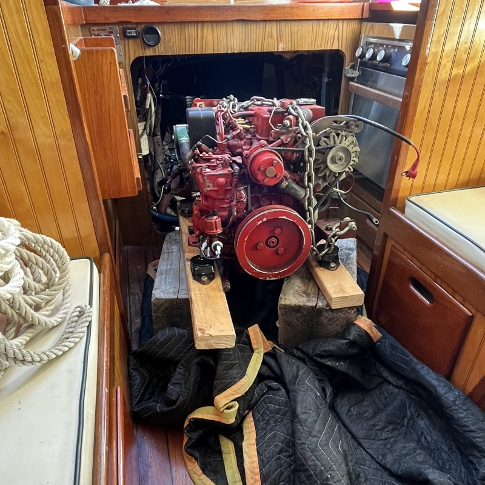
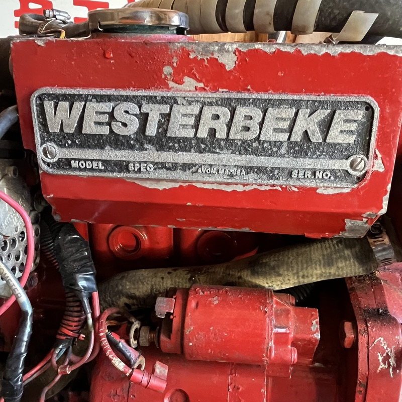
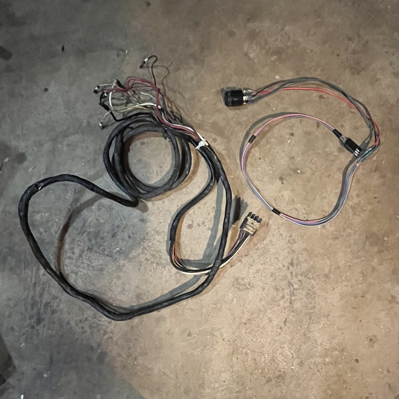
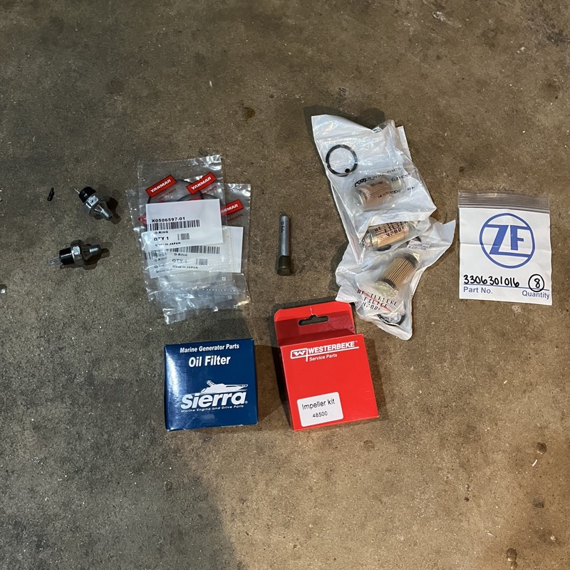

# {{ page.title }} #

1981 Westerbeke 30B 27HP from a 1967 Allied Seabreeze. Rebuilt
in 2010 with less than 300 hours runtime since. Hurth tranmission,
alternator, instruments and wiring harnesses included.
Runs perfectly and rigorously maintained.
Video available showing operation in boat before being pulled. Many spare parts. 

### Serious inquiries, contact ###

  * Tim Herzog
  * (202) 299-4406 (voice or text)
  * <potomacboatcraft@gmail.com>

### Vitals ###

* Model: Westerbeke 30B3
* Serial #: 40785-C103
* Manufacture Date: 3/1981
* Transmission: Hurth HBW 100-2, S/N 1515101-B
* Last Rebuild: 3/2010
* Engine Hours Since Rebuild (est): 260
* Specifications (from manual):
  * Cylinders: 3
  * Horsepower: 27
  * Stroke: 2.76 in
  * Displacement: 59.09 cubic in
  * Dimensions (HWL): 19.75 x 16 X 28.81 in
  * Weight: 272 lbs
  * Idle speed: 1000-1200rpm
  * Cruise speed: 2500-3000rpm (3600 max)
* Included in Sale:
  * Admiral panel, tachometer, oil and temperature gauges
  * Spare oil filters, onboard fuel filters, impellers, lift pump, zincs
* Location: Rockhold Creek Marina, Deale, MD

### Photos & Videos (11/2026) ###

<iframe src="https://www.youtube.com/embed/B-7k4rLH_2g" frameborder="0" allow="accelerometer; autoplay; clipboard-write; encrypted-media; gyroscope; picture-in-picture" allowfullscreen></iframe>

