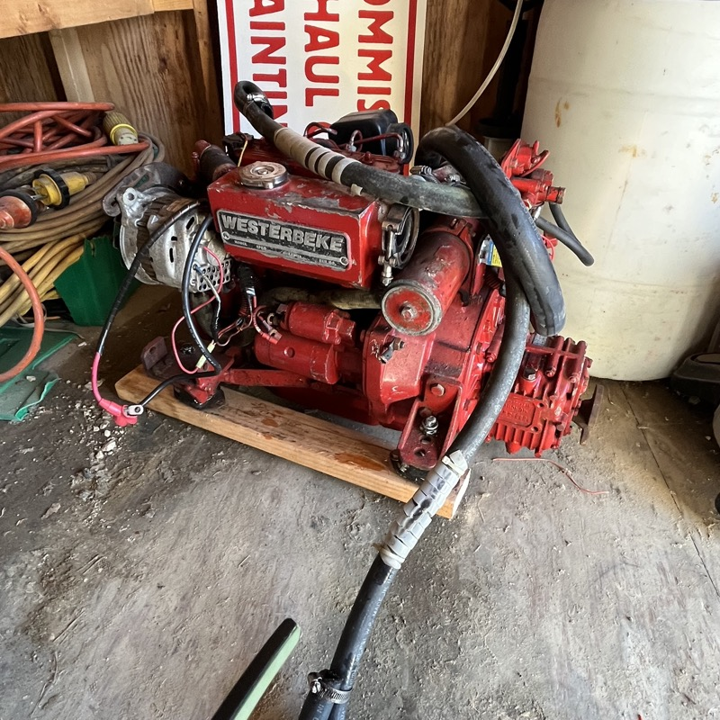
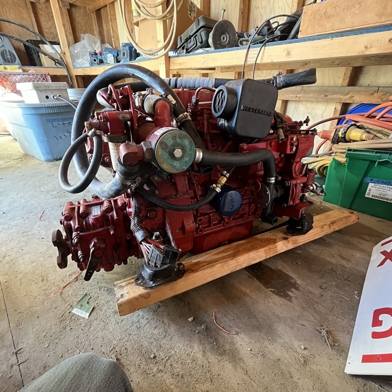
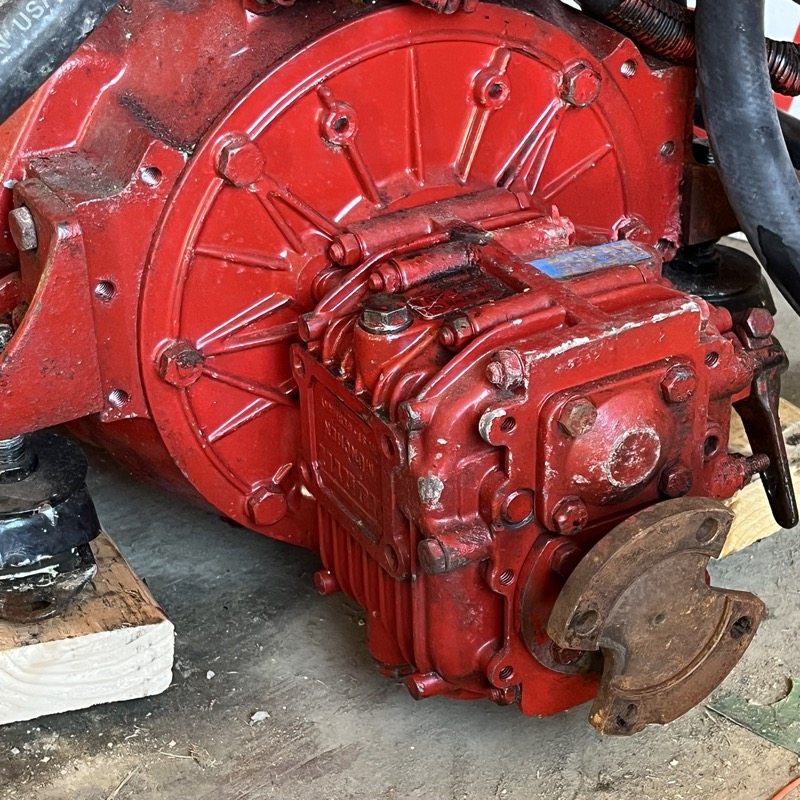
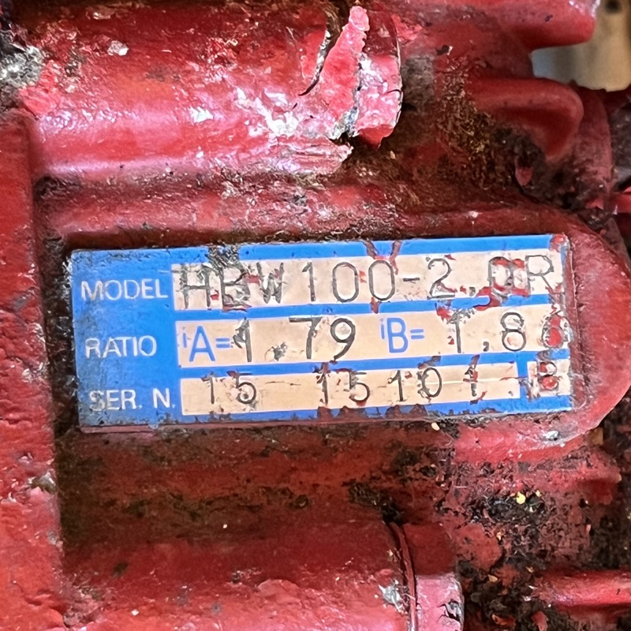
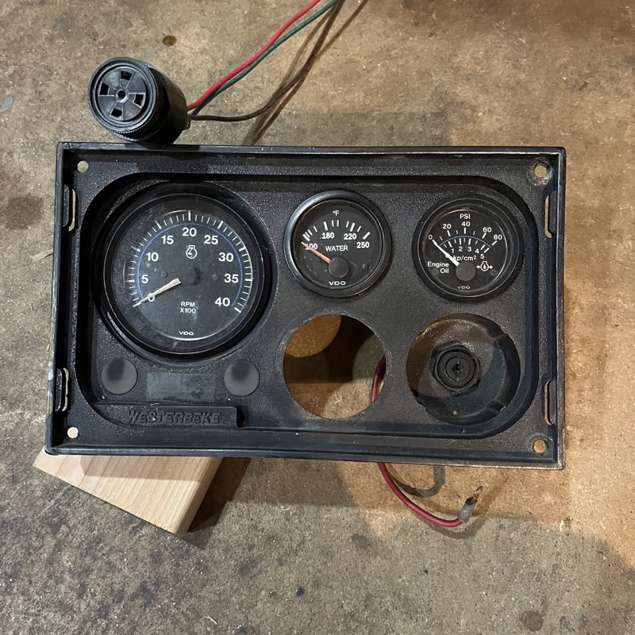

# {{ page.title }} #

I'm repowering my 1967 Allied Seabreeze with a new engine, and so I'll be selling
my Westerbeke 30B3.

This was the engine that came with the boat when my father purchased it in 2010.
It was rebuilt shortly after purchase. Since then, it's been extremely reliable
and I've followed the maintenance schedule to the letter. Except for a transit
from Cape Cod to the Chesapeake in 2011, it's been almost entirely used
to get in and out of the marina for day sails. There was a period where
the engine clock wiring was on the fritz, so engine hours are an estimate,
but I think it's a pretty good estimate.

### Serious inquiries, contact ###

  * Tim Herzog
  * (202) 299-4406 (voice or text)
  * <potomacboatcraft@gmail.com>

### Vitals ###

* Model: Westerbeke 30B3
* Serial #: 40785-C103
* Manufacture Date: 3/1981
* Transmission: Hurth HBW 100-2, S/N 1515101-B
* Last Rebuild: 3/2010
* Engine Hours Since Rebuild (est): 260
* Included in Sale:
  * Admiral panel, tachometer, oil and temperature gauges
  * Spare oil filters, onboard fuel filters, impellers, zincs
* Location: Rockhold Creek Marina, Deale, MD

### Photos & Videos (11/2026) ###

<iframe src="https://www.youtube.com/embed/B-7k4rLH_2g" frameborder="0" allow="accelerometer; autoplay; clipboard-write; encrypted-media; gyroscope; picture-in-picture" allowfullscreen></iframe>

